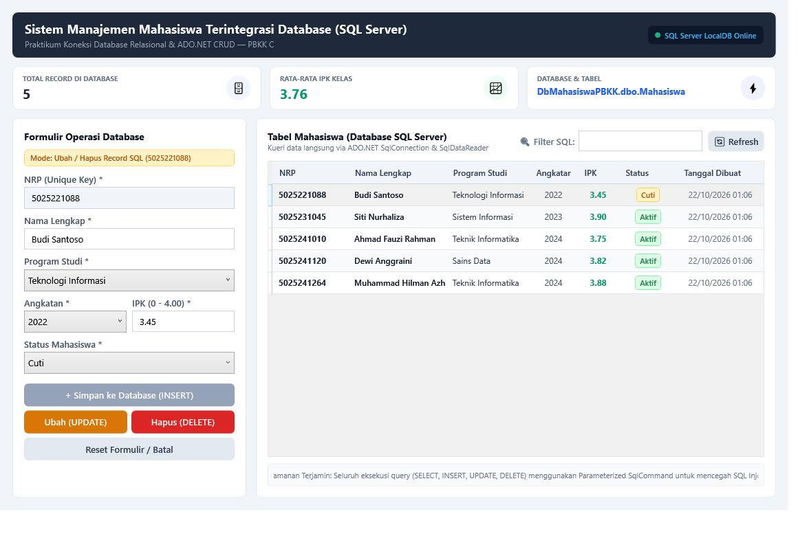

# Pertemuan 06: Integrasi Desktop WPF dengan Database Relasional SQL Server

Implementasi persistensi data aplikasi desktop WPF terintegrasi langsung dengan Microsoft SQL Server (LocalDB) menggunakan ADO.NET (`Microsoft.Data.SqlClient`) untuk tugas Pertemuan 06 mata kuliah Pemrograman Berbasis Kerangka Kerja (PBKK) C.

## Identitas
- **Nama:** Muhammad Hilman Azhar
- **NRP:** 5025241264
- **Kelas:** PBKK C
- **Dosen Pengampu:** Fajar Baskoro, S.Kom., M.T.
- **Laporan Notion:** [Buka Laporan di Notion](https://app.notion.com/p/Pertemuan-6-Integrasi-WPF-dengan-Database-Relasional-SQL-Server-4009c0720c5a813c8ae6e803436430fc)

## Deskripsi Singkat
Aplikasi ini menghubungkan antarmuka desktop WPF ke server database Microsoft SQL Server LocalDB (`(localdb)\MSSQLLocalDB`) secara persisten:
1. **Arsitektur Database Relasional (`database.sql`):**
   - Skrip DDL/DML lengkap untuk inisialisasi database `DbMahasiswaPBKK` dan tabel `Mahasiswa`.
   - Penerapan *constraint* integritas data: `PRIMARY KEY IDENTITY(1,1)`, `NRP VARCHAR(15) UNIQUE`, `CHECK (Ipk >= 0.00 AND Ipk <= 4.00)`, dan `DEFAULT GETDATE()`.
2. **Konektivitas & Query ADO.NET (`Data/DatabaseHelper.cs`):**
   - Menggunakan objek inti ADO.NET: `SqlConnection`, `SqlCommand`, dan `SqlDataReader`.
   - Seluruh query SQL menggunakan parameter (`@Nrp`, `@Nama`, `@Prodi`, dsb.) untuk mencegah celah keamanan SQL Injection.
   - Pengecekan otomatis dan pembuatan database saat aplikasi pertama kali dijalankan (*Auto-provisioning & Seeding*).
3. **Operasi CRUD Database:**
   - **SELECT (Read):** Menampilkan seluruh baris dari database ke `DataGrid` dan mendukung filter pencarian teks berbasis SQL `LIKE`.
   - **INSERT (Create):** Menambahkan baris mahasiswa baru ke tabel SQL dengan pengecekan keunikan NRP terlebih dahulu.
   - **UPDATE (Update):** Memperbarui atribut mahasiswa terpilih berdasarkan NRP.
   - **DELETE (Delete):** Menghapus record mahasiswa dari tabel database dengan dialog konfirmasi.
4. **Agregasi Metrik Database:**
   - Menghitung total data aktif (`COUNT`) dan rata-rata IPK (`AVG`) secara langsung via query SQL agregasi.

## Struktur Berkas
- `database.sql`: Skrip SQL terstruktur untuk pembuatan database, skema tabel, dan data awal.
- `Data/DatabaseHelper.cs`: Kelas penyedia fungsi CRUD dan manajemen koneksi database ADO.NET.
- `Models/Mahasiswa.cs`: Definisi model objek entitas mahasiswa.
- `MainWindow.xaml`: Desain visual antarmuka integrasi database.
- `MainWindow.xaml.cs`: Logika interaksi pengguna dan pemanggilan fungsi database.
- `Pertemuan-06-WPF-SQLServer-Integration.csproj`: Berkas proyek .NET 10.0 WPF dengan paket `Microsoft.Data.SqlClient`.
- `screenshots/database_crud_gui.png`: Tangkapan layar bukti eksekusi program yang tersambung ke database.

## Cara Menjalankan
Pastikan SQL Server LocalDB telah aktif (otomatis tersedia pada instalasi Visual Studio / .NET SDK di Windows).

```bash
dotnet run
```

## Hasil Eksekusi
Tampilan jendela aplikasi manajemen mahasiswa terhubung ke database SQL Server:


